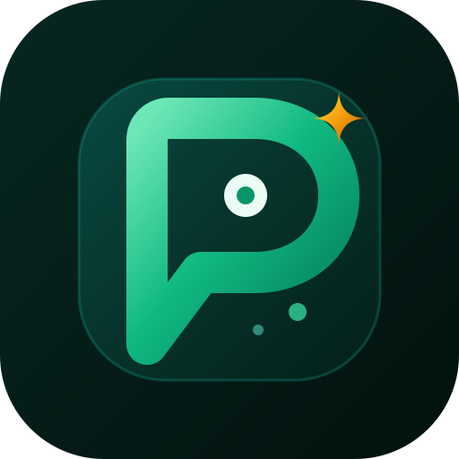

<div align="center">



# Persona B2B — Meta Model API Edition

[](https://kotlinlang.org)
[](https://developer.android.com)
[](https://developer.android.com/jetpack/compose)
[](https://dev.meta.ai)
[](#%EF%B8%8F-build--installation-guide)
[](https://www.gnu.org/licenses/agpl-3.0)

</div>

> **Persona B2B** is an autonomous, bilingual (Arabic/English) AI communication and stateful commerce engine for Android. Engineered exclusively on the official **Meta Model API** (`Muse Spark 1.3`, `Muse Spark 1.2`, and `Muse Voice Transcribe 1.0`), it empowers small and medium businesses (SMBs) as a full-cycle sales & order agent—or operates as an isolated **Personal Executive Assistant**—with zero third-party AI model dependencies at runtime.

---

## 🏗️ System Architecture & End-to-End Execution Flow

```text
+-----------------------------------------------------------------------------------+
|                        1. INBOUND CHANNELS & LIVE SIMULATOR                       |
|  • Live WhatsApp Notification Listener  OR  • Interactive In-App Bot Simulator    |
|  • Text Queries / Dynamic FAQ Chips     OR  • Live 16kHz Mic Voice Recording      |
+-----------------------------------------+-----------------------------------------+
                                          |
                                          v
+-----------------------------------------------------------------------------------+
|                     2. HARDWARE MEDIA & META VOICE PIPELINE                       |
|  • On-Device AudioWavConverter (Android MediaCodec -> 16kHz Mono PCM WAV)         |
|  • Meta Model API ASR: `muse-voice-transcribe-1.0` (Speech-to-Text Transcription) |
+-----------------------------------------+-----------------------------------------+
                                          |
                                          v
+-----------------------------------------------------------------------------------+
|            3. ZERO-COLD-START DETERMINISTIC RAG ENGINE (0ms Overhead)             |
|  • Bilingual Normalization (Arabic/English) + Colloquial Synonym Expansion Layer  |
|  • Deterministic 384-Dim Signed Feature Hashing + BM25 Lexical Scoring            |
|  • Room SQLite Vector Index (`FloatArray(384)`) -> Top-8 Context Chunks (topK=8)  |
+-----------------------------------------+-----------------------------------------+
                                          |
                                          v
+-----------------------------------------------------------------------------------+
|               4. UNIFIED SINGLE-STAGE META AI REASONING ENGINE                    |
|  • Single-Pass Prompt: Chat History + Top-8 Knowledge Chunks + Active Orders      |
|  • Primary Engine: `muse-spark-1.3` <--> `muse-spark-1.3-contributor`             |
|    (Automatic HTTP 404 Transparent Entitlement Failover)                          |
|  • Secondary Meta Fallback: `muse-spark-1.2` <--> `muse-spark-1.2-contributor`    |
|  • Multi-Key Pool Rotation, Circuit Breakers & `<think>` Trace Sanitization       |
+-----------------------------------------+-----------------------------------------+
                                          |
                    +---------------------+---------------------+
                    |                                           |
                    v (B2B Merchant Mode)                       v (Personal Assistant Mode)
+---------------------------------------+   +---------------------------------------+
|   5A. STATEFUL COMMERCE & ORDERS      |   |   5B. EXECUTIVE AUTO-PILOT            |
|  • Autonomous JSON Order Extraction   |   |  • Context-Aware Personal Replies     |
|  • Room DB Order Lifecycle Tracking   |   |  • Meeting & Schedule Coordination    |
|  • Direct Reply & HITL Escalation     |   |  • Isolated from Commercial Tools     |
+---------------------------------------+   +---------------------------------------+
```

---

## 🌟 Core Pillars & Hackathon Innovations

### 1. 100% Exclusive Meta Model API Runtime
Every AI model invoked at runtime is an official Meta model via `MetaModelApiClient.kt`:
- **`muse-spark-1.3` & `muse-spark-1.3-contributor`**: Powers unified single-stage reasoning—simultaneously handling intent understanding, RAG grounded synthesis, conversational nuances, and structured JSON order extraction in a single authoritative pass.
- **`muse-spark-1.2` & `muse-spark-1.2-contributor`**: Serves as the secondary Meta reasoning tier.
- **`muse-voice-transcribe-1.0`**: Transcribes incoming customer voice notes and live simulator microphone recordings with high accuracy across English and colloquial Arabic.
- **Transparent Entitlement Failover**: Automatically detects HTTP `404 model_not_found` responses and transparently switches between standard model IDs (`muse-spark-1.3`) and hackathon contributor variants (`muse-spark-1.3-contributor`) on the fly, ensuring 100% compatibility with any judge's API key.
- **Dynamic Key Pool & Circuit Breakers**: Supports rotating across multiple Meta API keys with exponential backoff and human-in-the-loop (HITL) escalation if rate limits are exhausted.

### 2. Zero-Startup Deterministic 384-Dim RAG with Synonym Expansion
- **Zero External AI Models**: Replaces heavy third-party embedding downloads with a pure mathematical **Multilingual Feature Hashing & BM25 Vector Engine** (`EmbeddingEngine.kt`).
- **0-Second Cold Start**: Launches instantly with zero model download wait times while preserving a native `FloatArray(384)` vector layout in Room SQLite.
- **Colloquial & Commerce Synonym Expansion**: Pre-expands regional and commercial terms prior to hashing (e.g., mapping `هاتف` $\leftrightarrow$ `موبايل/جوال/فون`, `سعر` $\leftrightarrow$ `بكام/تكلفة`, `شحن` $\leftrightarrow$ `توصيل/دليفري`, `order` $\leftrightarrow$ `طلب/اوردر`).
- **Deep Context Window (`topK = 8`)**: Supplies the top 8 most relevant knowledge chunks directly to `Muse Spark 1.3` for comprehensive domain grounding.

### 3. Interactive Bot Simulator with Live Voice Recording & Dynamic FAQs
- **No WhatsApp Setup Needed for Judges**: Test the entire end-to-end Meta AI pipeline inside the built-in **Bot Simulator** bottom sheet.
- **Live Microphone Recording**: Record real-time 16kHz mono PCM WAV voice notes directly inside the simulator (`LiveAudioRecorder.kt`), complete with runtime permission handling, pulse/timer animations, hardware WAV conversion, and live transcription via `muse-voice-transcribe-1.0`.
- **Dynamic Suggested FAQ Chips**: Automatically parses indexed knowledge headings and product entities to generate 4–6 clickable suggested question chips tailored to the currently active knowledge base.

### 4. 1-Click Bilingual Sample Knowledge & Dual Modes (B2B vs. Personal)
- **4 Built-In Sample Templates (Arabic & English)**: Depending on your active UI language (Arabic or English), the Knowledge Studio and Bot Simulator display **2 instant 1-click injection buttons**:
  1. **Load Business / Sales Sample**: Injects a complete retail merchant catalog (products, sizes, stock, shipping rates, return policies, and payment methods).
  2. **Load Personal Assistant Sample**: Injects an executive assistant profile (working hours, scheduling rules, bio, and priority contact protocols).
- **Custom Knowledge with Meta AI**: Copy the built-in structured Knowledge Prompt from the app to generate your own custom domain knowledge with **Meta AI** and import it in seconds.

---

## 🚀 Step-by-Step Walkthrough (How to Use & Test the App)

When you launch **Persona B2B**, the app guides you through a seamless setup flow:

1. **Guided Onboarding & Permissions**:
   - Follow the interactive onboarding cards to grant notification and microphone permissions (see the [Android 13/14+ Sideloading Note](#-important-notes-for-judges-apk-sideloading--android-1314-permissions) below if testing live OS notifications).
2. **Enter Your Meta Model API Key**:
   - Navigate to **Settings $\rightarrow$ AI Engine** (or the Onboarding API step) and paste your **Meta Model API Key** from `dev.meta.ai` (if not already pre-configured via `secrets.local.properties` at build time).
3. **Select Persona Mode & Customize Identity**:
   - Choose between **B2B Sales Assistant Mode** or **Personal Assistant Mode**, and customize your assistant's name, tone, and fallback rules.
4. **Inject Knowledge (1-Click Samples or Custom Import)**:
   - Open the **Knowledge Studio (Import Knowledge)** tab.
   - **Fastest Path for Judges**: Tap either **"Load Business Knowledge"** or **"Load Personal Knowledge"**. The app automatically loads the matching **English or Arabic** pre-packaged sample based on the current app language and indexes it in milliseconds.
   - **Custom Path**: Copy the built-in prompt template, generate a custom knowledge base using **Meta AI**, and import the Markdown file/text.
5. **Test Live in the Bot Simulator (or via Real WhatsApp)**:
   - Tap the **Bot Simulator** button to open the interactive sandbox:
     - Tap any **Dynamic FAQ Chip** to test instant RAG grounding.
     - Tap the **Microphone Icon** to record a live voice query (`muse-voice-transcribe-1.0` $\rightarrow$ `muse-spark-1.3`).
     - **In B2B Mode**: Ask about product prices, shipping, or place a complete order (name, phone, address, items)—watch `Muse Spark 1.3` autonomously extract the order and populate the **Orders Dashboard**!
     - **In Personal Mode**: Test executive scheduling, availability inquiries, and personal message filtering.

---

## ⚠️ Important Notes for Judges (APK Sideloading & Android 13/14+ Permissions)

Because this application is distributed directly as a standalone APK outside the Google Play Store for hackathon evaluation, Android's built-in OS security applies two standard restrictions to sideloaded apps:

### 1. Installing the Signed Release APK (Google Play Protect)
> **"Application is built with an official v1/v2 cryptographic release signature. When installing outside Google Play, tap 'More details' $\rightarrow$ 'Install anyway' if prompted by Google Play Protect (or temporarily pause Play Protect during installation)."**

*(Note: If you onely wish to evaluate the Meta AI reasoning, RAG retrieval, order extraction, and live voice transcription via the in-app **Bot Simulator**, no special OS notification permissions are required!)*

### 2. Unlocking "Restricted Settings" for Notification Access (Android 13 / 14 / 15)
If you install the APK directly on a physical Android 13, 14, or 15 device (e.g., Realme, Xiaomi, Samsung, Pixel) and want to test **live WhatsApp notification interception**, Android automatically grays out the **Notification Listener** toggle for any app installed outside Google Play under a security feature called **Restricted Settings (الإعدادات المحظورة)**—even when the APK is officially release-signed.

**To enable Notification Access in 5 quick steps:**
1. **Open App Info**: Long-press the **Persona B2B** icon on your home screen or app drawer and tap **App Info `(i)`** (معلومات التطبيق).
2. **Open the Overflow Menu**: Tap the **three vertical dots (`⋮`)** in the top-right or top-left corner of the App Info screen.
3. **Allow Restricted Settings**: Select **"Allow restricted settings"** (السماح بالإعدادات المحظورة).
4. **Verify Identity**: Authenticate using your device's screen lock (fingerprint, face unlock, or PIN).
5. **Grant Notification Access**: Return to **Device & app notifications** (إشعارات التطبيقات والأجهزة) and toggle **Persona B2B** ON. It will now activate immediately without restriction!

---

## 🛠️ Build & Installation Guide

### Prerequisites
- **Android Studio** Ladybug (2024.2.1+) or newer
- **JDK 17**
- **Android SDK 35** (Compile SDK 35 / Min SDK 26)

### 🔑 Crucial Note on API Keys (Before Building vs. In-App UI)
In `app/build.gradle.kts`, the build system automatically checks for `META_API_KEY` inside **`secrets.local.properties`** (or `secrets.properties`) in the root project directory:
- **Option 1 (Pre-configure before building — Zero UI Setup)**:
  Create `secrets.local.properties` in the root directory of the project and add your key so the compiled app works out-of-the-box:
  ```properties
  META_API_KEY=your_meta_model_api_key_here
  META_BASE_URL=[https://api.meta.ai/v1](https://api.meta.ai/v1)
  ```
- **Option 2 (Configure anytime via In-App UI)**:
  If you build without `secrets.local.properties` (or install the pre-built APK), simply open the app and enter your key directly in **Settings $\rightarrow$ AI Engine $\rightarrow$ Meta Model API Key**. Keys are encrypted on-device via `EncryptedSharedPreferences`.

### 1. Building & Installing the Debug APK
To compile and install the debug build on a connected device or emulator:
```bash
# Build the Debug APK
./gradlew assembleDebug

# Or build and install directly via ADB
./gradlew installDebug
```
*Output path:* `app/build/outputs/apk/debug/app-debug.apk`

### 2. Building the Signed Release APK
To compile the R8-optimized, production-signed release APK:
```bash
./gradlew assembleRelease
```
*Output path:* `app/build/outputs/apk/release/app-release.apk`

### 3. Running the Automated Unit Test Suite (640+ Tests)
Verify the deterministic RAG engine, synonym expansion, single-stage orchestrator, and Meta Model API client failover logic:
```bash
./gradlew testDebugUnitTest
```

---

## 📄 License

This project is open-source and licensed under the **GNU Affero General Public License v3.0 (AGPLv3)**. See the [LICENSE](LICENSE) file for full details.